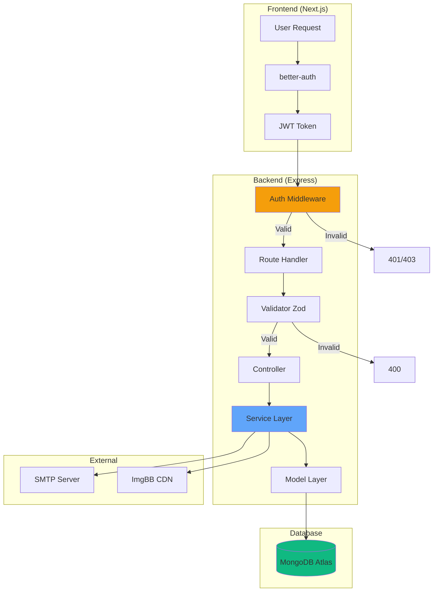
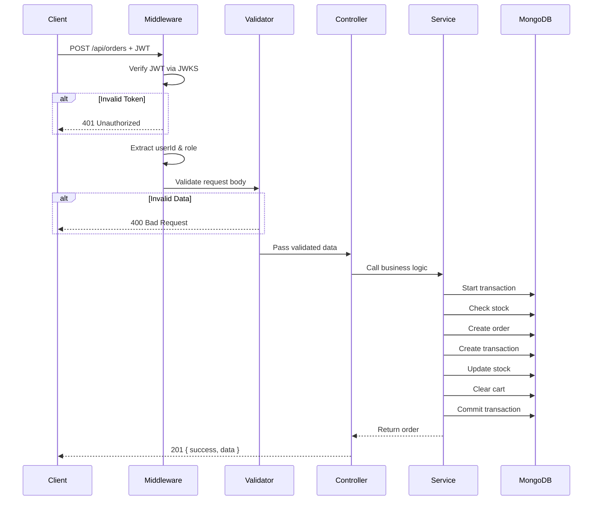
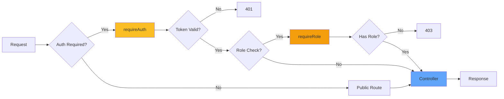
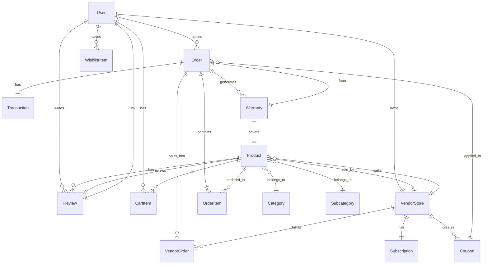
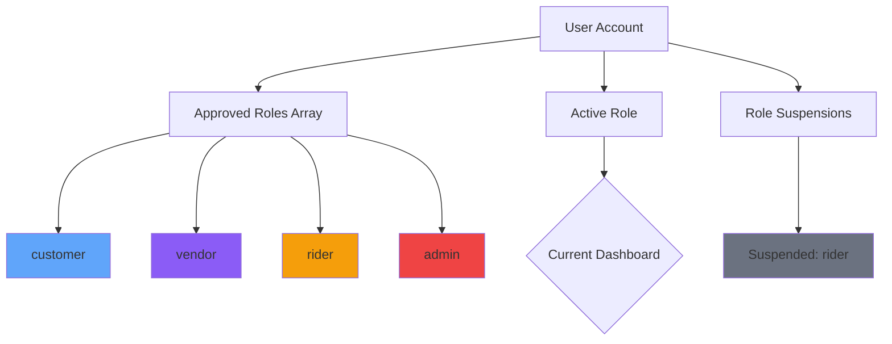
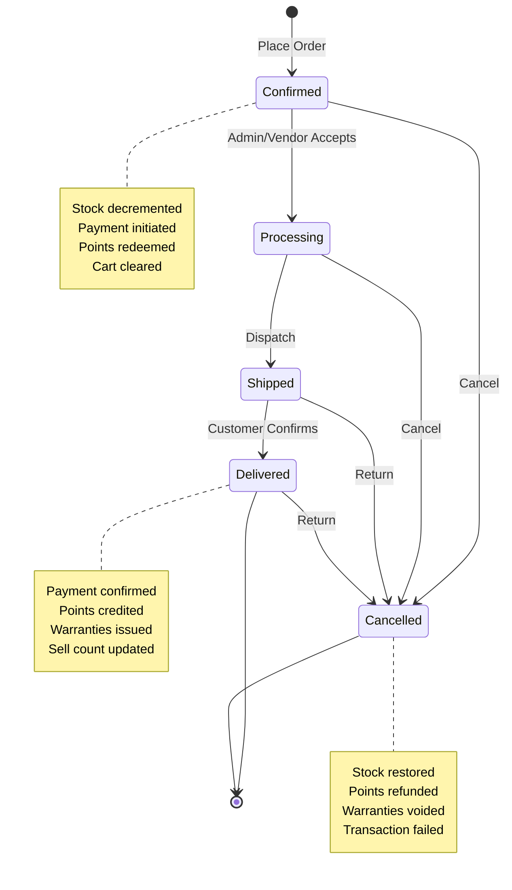
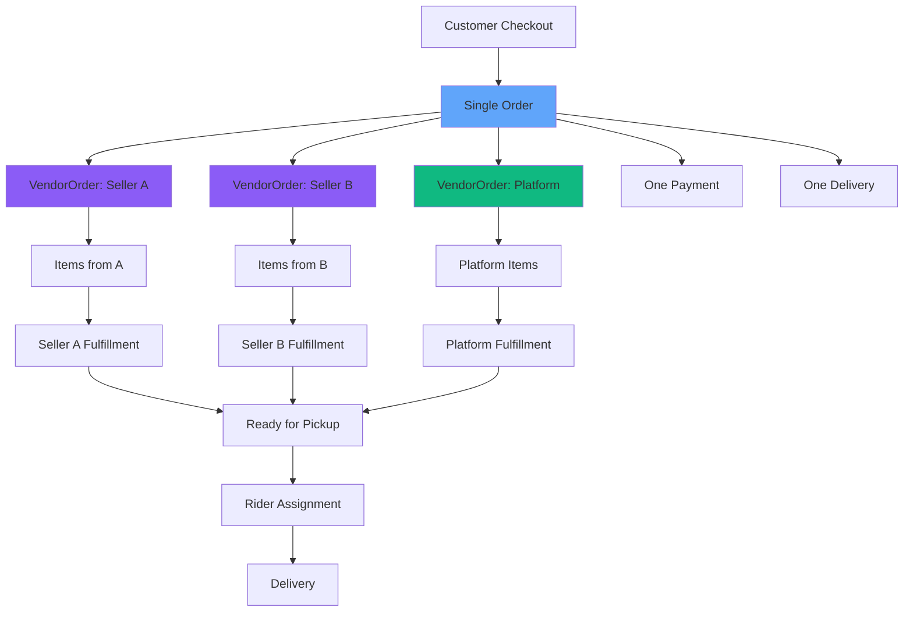
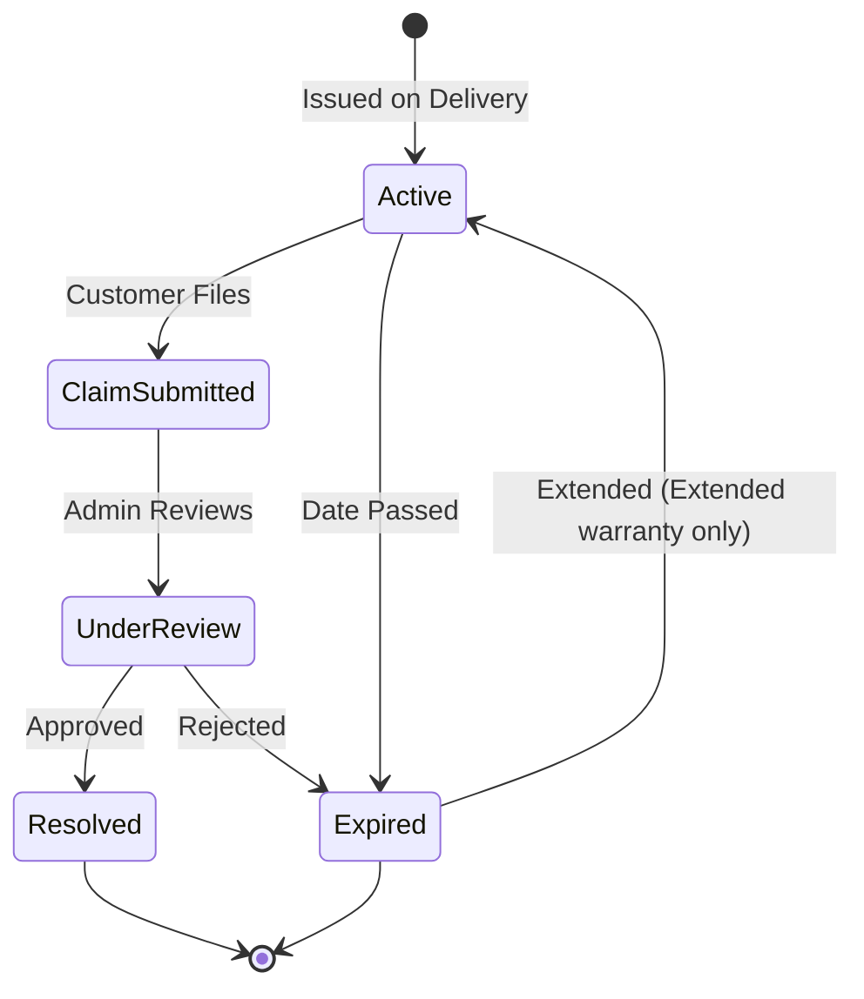
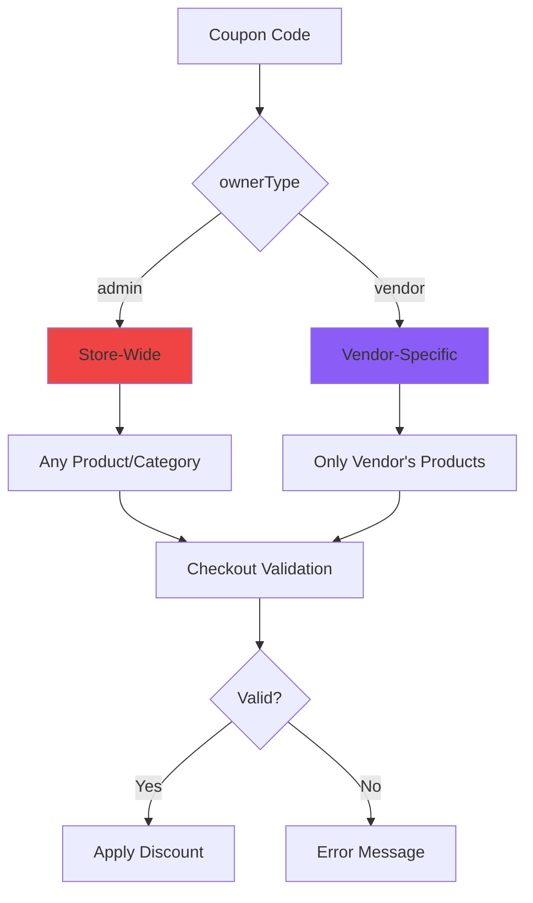
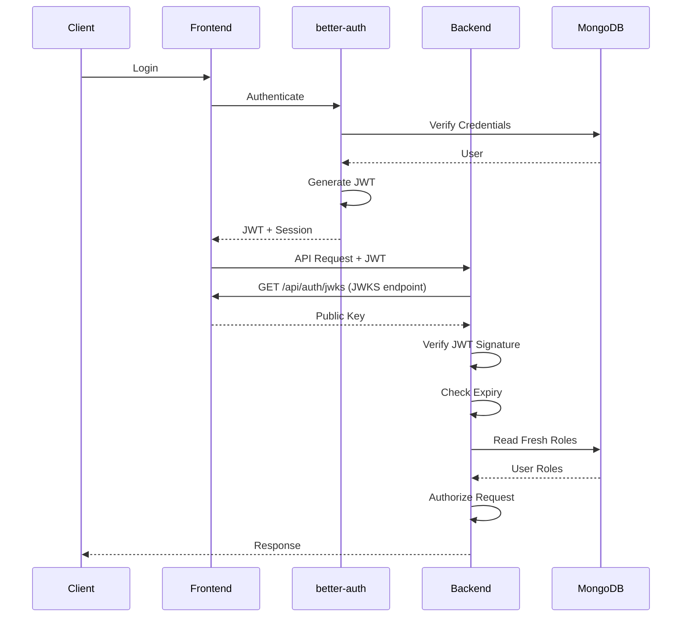

<div align="center">

# ⚡ Sparq — Backend API

### *REST API for a full-stack e-commerce platform*

**Express 5 + MongoDB backend powering catalog, orders, multi-vendor marketplace, loyalty, warranties, and comprehensive CMS**

[](https://sparq-api.vercel.app/api)
[](https://github.com/demoprojectbdsoft/Sparq-Server)
[](https://github.com/demoprojectbdsoft/Sparq-Electronics-Store)

</div>

---

## 📑 Table of Contents

1. [Overview](#-overview)
2. [Architecture](#️-architecture)
3. [API Documentation](#-api-documentation)
4. [Business Rules](#-business-rules)
5. [Security](#-security)
6. [Tech Stack](#-tech-stack)
7. [Project Structure](#-project-structure)
8. [Setup & Installation](#-setup--installation)
9. [Environment Variables](#-environment-variables)
10. [Development](#-development)
11. [Deployment](#-deployment)
12. [Project Status](#-project-status)
13. [Contributing](#-contributing)
14. [License](#-license)

---

## 📖 Overview

Sparq-Server is the backend API for the [Sparq](https://github.com/demoprojectbdsoft/Sparq-Electronics-Store) e-commerce platform. It handles all business logic, data persistence, and authorization while the Next.js frontend owns authentication.

### Core Responsibilities

**✅ What This Server Owns**

| Responsibility | Description |
|---------------|-------------|
| **Business Logic** | All pricing, discounts, shipping, points, and totals computed server-side |
| **Authorization** | JWT verification, role guards, ownership checks on every request |
| **Data Integrity** | Transactional order processing, atomic points operations, stock management |
| **Scheduled Jobs** | Demo restore, warranty expiry, delivery cleanup, subscription renewals |
| **Email Delivery** | Transactional emails via SMTP (orders, warranties, password resets) |

**❌ What This Server Does NOT Own**

- **Authentication**: Sign-up, login, sessions, and JWTs handled by better-auth in frontend
- **Session Storage**: Frontend stores sessions in MongoDB; backend only verifies tokens

### System Architecture



### Request Flow



---

## 🏗️ Architecture

### Layered Architecture

Every module follows the same five-layer pattern for consistency:

```
┌─────────────────────────────────────┐
│         route.ts                    │  Maps URLs to controllers
│  - Defines HTTP methods & paths    │  Attaches auth/role middleware
│  - Mounts validators               │
└─────────────────────────────────────┘
                 ↓
┌─────────────────────────────────────┐
│       validator.ts                  │  Zod schemas
│  - Validates request body/params   │  Rejects invalid input early
│  - Type-safe validation            │
└─────────────────────────────────────┘
                 ↓
┌─────────────────────────────────────┐
│      controller.ts                  │  HTTP layer
│  - Reads request                   │  Calls service
│  - Sends response (apiResponse)    │  Error handling
└─────────────────────────────────────┘
                 ↓
┌─────────────────────────────────────┐
│       service.ts                    │  Business logic
│  - Computes prices, totals         │  Database operations
│  - Enforces business rules         │  Calls other services
└─────────────────────────────────────┘
                 ↓
┌─────────────────────────────────────┐
│        model.ts                     │  Mongoose schema
│  - Defines data structure          │  Indexes, virtuals
│  - Validation rules                │
└─────────────────────────────────────┘
```

### Module Organization

```
src/modules/
├── product/
│   ├── product.model.ts          # Mongoose schema
│   ├── product.service.ts        # Business logic
│   ├── product.controller.ts     # HTTP handlers
│   ├── product.validator.ts      # Zod schemas
│   ├── product.route.ts          # Express routes
│   └── product.types.ts          # TypeScript types
│
├── order/                        # Order processing
├── user/                         # User management
├── vendor/                       # Vendor marketplace
├── warranty/                     # Warranty system
└── ...
```

### Middleware Pipeline



### Database Schema Overview



---

## 📚 API Documentation

Base URL: `/api`  
All responses: `{ success: boolean, message: string, data?: any }`

### Access Levels

| Icon | Access Level | Description |
|------|-------------|-------------|
| 🌐 | **Public** | No authentication required |
| 🔐 | **Bearer** | Valid JWT token required |
| 👑 | **Admin** | Admin or demo admin role required |
| ⏰ | **Cron** | CRON_SECRET or Vercel cron header required |
| 🔑 | **Internal** | INTERNAL_API_KEY header required (frontend only) |

### Authentication & Users

#### Users

| Method | Endpoint | Access | Description |
|--------|----------|--------|-------------|
| `GET` | `/users` | 👑 | List all users (paginated, searchable) |
| `GET` | `/users/me/roles` | 🔐 | Get current user's roles and status |
| `GET` | `/users/me/export` | 🔐 | Export user data as JSON |
| `PATCH` | `/users/me/active-role` | 🔐 | Switch active dashboard role |
| `GET` | `/users/:id` | 🔐 | Get user by ID (owner or admin) |
| `PATCH` | `/users/:id` | 🔐 | Update user (owner limited, admin full) |
| `POST` | `/users/:id/roles` | 👑 | Set user's approved roles |
| `PATCH` | `/users/:id/roles/revoke` | 👑 | Revoke a single role |
| `PATCH` | `/users/:id/roles/suspension` | 👑 | Suspend/unsuspend a role |
| `DELETE` | `/users/:id` | 👑 | Delete user account |

#### Saved Addresses

| Method | Endpoint | Access | Description |
|--------|----------|--------|-------------|
| `GET` | `/addresses` | 🔐 | List user's saved addresses |
| `POST` | `/addresses` | 🔐 | Add new address |
| `PATCH` | `/addresses/:id` | 🔐 | Update address |
| `PATCH` | `/addresses/:id/default` | 🔐 | Set as default |
| `DELETE` | `/addresses/:id` | 🔐 | Delete address |

### Catalog

#### Categories

| Method | Endpoint | Access | Description |
|--------|----------|--------|-------------|
| `GET` | `/categories` | 🌐 | List all categories |
| `POST` | `/categories` | 👑 | Create category |
| `PATCH` | `/categories/:id` | 👑 | Update category |
| `DELETE` | `/categories/:id` | 👑 | Delete category (cascades to subcategories) |

#### Subcategories

| Method | Endpoint | Access | Description |
|--------|----------|--------|-------------|
| `GET` | `/subcategories` | 🌐 | List all subcategories |
| `POST` | `/subcategories` | 👑 | Create subcategory |
| `PATCH` | `/subcategories/:id` | 👑 | Update subcategory |
| `DELETE` | `/subcategories/:id` | 👑 | Delete subcategory |

#### Products

| Method | Endpoint | Access | Description |
|--------|----------|--------|-------------|
| `GET` | `/products` | 🌐 | Search & filter products |
| `GET` | `/products/:slug` | 🌐 | Get single product |
| `POST` | `/products` | 👑 | Create product |
| `PATCH` | `/products/:id` | 👑 | Update product |
| `DELETE` | `/products/:id` | 👑 | Delete product |

**Query Parameters for `/products`:**
```
?search=          # Search in title, brand, description
?category=        # Filter by category ID
?subcategory=     # Filter by subcategory ID
?minPrice=        # Minimum price
?maxPrice=        # Maximum price
?hasOffer=true    # Only products with discounts
?storeSlug=       # Filter by vendor store
?sort=            # newest | price-asc | price-desc | rating | popular
?page=1           # Page number
?limit=12         # Items per page
```

#### Homepage Content

| Method | Endpoint | Access | Description |
|--------|----------|--------|-------------|
| `GET` | `/slides` | 🌐 | Get hero slider slides |
| `POST` | `/slides` | 👑 | Create slide |
| `PATCH` | `/slides/:id` | 👑 | Update slide |
| `DELETE` | `/slides/:id` | 👑 | Delete slide |
| `GET` | `/promos` | 🌐 | Get promo banners |
| `POST` | `/promos` | 👑 | Create promo banner |
| `PATCH` | `/promos/:id` | 👑 | Update promo banner |
| `DELETE` | `/promos/:id` | 👑 | Delete promo banner |

### Shopping

#### Cart

| Method | Endpoint | Access | Description |
|--------|----------|--------|-------------|
| `GET` | `/cart` | 🔐 | Get user's cart |
| `GET` | `/cart/is-carted?productId=` | 🔐 | Check if product in cart |
| `POST` | `/cart` | 🔐 | Add item to cart |
| `PATCH` | `/cart/:productId` | 🔐 | Update quantity |
| `DELETE` | `/cart` | 🔐 | Clear cart |
| `DELETE` | `/cart/:productId` | 🔐 | Remove item |

#### Wishlist

| Method | Endpoint | Access | Description |
|--------|----------|--------|-------------|
| `GET` | `/wishlist` | 🔐 | Get user's wishlist |
| `GET` | `/wishlist/is-wishlisted?productId=` | 🔐 | Check if product wishlisted |
| `POST` | `/wishlist` | 🔐 | Add to wishlist |
| `DELETE` | `/wishlist/:productId` | 🔐 | Remove from wishlist |

#### Orders

| Method | Endpoint | Access | Description |
|--------|----------|--------|-------------|
| `GET` | `/orders` | 🔐 | List orders (customer: own, admin: all) |
| `GET` | `/orders/:id` | 🔐 | Get order details (owner or admin) |
| `POST` | `/orders` | 🔐 | Place new order |
| `PATCH` | `/orders/:id/status` | 👑 | Update order status |
| `PATCH` | `/orders/:id/customer-response` | 🔐 | Report delivery outcome |
| `GET` | `/order-status?orderId=` | 🔐 | Get status history |

**Place Order Request:**
```json
{
  "items": [
    { "productId": "...", "quantity": 2 }
  ],
  "shippingAddress": {
    "fullName": "John Doe",
    "phone": "+1234567890",
    "address": "123 Main St",
    "city": "New York",
    "postalCode": "10001"
  },
  "paymentMethod": "cod" | "bkash" | "rocket" | "nagad",
  "transactionId": "TXN123",  // for mobile wallets
  "useRewardPoints": true,
  "couponCode": "SAVE10",
  "shippingMethod": "standard" | "express"
}
```

#### Transactions

| Method | Endpoint | Access | Description |
|--------|----------|--------|-------------|
| `GET` | `/transactions` | 🔐 | List payment records |

### Marketing

#### Coupons (Store-Wide)

| Method | Endpoint | Access | Description |
|--------|----------|--------|-------------|
| `GET` | `/coupons` | 👑 | List all coupons (admin & vendor) |
| `GET` | `/coupons/:id` | 👑 | Get single coupon |
| `POST` | `/coupons` | 👑 | Create store coupon |
| `PATCH` | `/coupons/:id` | 👑 | Update store coupon |
| `DELETE` | `/coupons/:id` | 👑 | Delete store coupon |
| `POST` | `/coupons/validate` | 🔐 | Validate coupon code |

**Coupon Types:**
- **Percentage**: 1-100% discount
- **Fixed**: Flat amount discount

**Scope:**
- `productIds`: Specific products
- `categoryIds`: Product categories
- Empty: All products (admin) or vendor's products

#### Featured Promotions (Admin)

| Method | Endpoint | Access | Description |
|--------|----------|--------|-------------|
| `GET` | `/promotions` | 👑 | List all featured placements |
| `POST` | `/promotions` | 👑 | Grant featured placement |
| `DELETE` | `/promotions/:id` | 👑 | End placement early |
| `GET` | `/promotions/expire` | ⏰ | Daily sweep (close expired) |

### Multi-Vendor

#### Vendor Applications

| Method | Endpoint | Access | Description |
|--------|----------|--------|-------------|
| `POST` | `/vendor-applications` | 🔐 | Submit application |
| `GET` | `/vendor-applications/mine` | 🔐 | Get own applications |
| `POST` | `/vendor-applications/mine/cancel` | 🔐 | Withdraw application |
| `GET` | `/vendor-applications` | 👑 | List all applications |
| `GET` | `/vendor-applications/:id` | 👑 | Get application details |
| `PATCH` | `/vendor-applications/:id/review` | 👑 | Approve/reject application |

#### Vendor Stores

| Method | Endpoint | Access | Description |
|--------|----------|--------|-------------|
| `GET` | `/vendor-store/public` | 🌐 | List trading stores |
| `GET` | `/vendor-store/public/:slug` | 🌐 | Get store by slug |
| `GET` | `/vendor-store` | 👑 | List all stores (admin) |
| `GET` | `/vendor-store/mine` | Vendor | Get own store |
| `PATCH` | `/vendor-store/mine` | Vendor | Update own store |

#### Vendor Products

| Method | Endpoint | Access | Description |
|--------|----------|--------|-------------|
| `GET` | `/vendor-products` | Vendor | List own products |
| `GET` | `/vendor-products/:id` | Vendor | Get own product |
| `POST` | `/vendor-products` | Vendor | Create product |
| `PATCH` | `/vendor-products/:id` | Vendor | Update product |
| `DELETE` | `/vendor-products/:id` | Vendor | Archive product |

#### Vendor Orders

| Method | Endpoint | Access | Description |
|--------|----------|--------|-------------|
| `GET` | `/vendor-orders` | Vendor | List fulfillment groups |
| `GET` | `/vendor-orders/summary` | Vendor | Order counts by status |
| `GET` | `/vendor-orders/:id` | Vendor | Get group details |
| `PATCH` | `/vendor-orders/:id/status` | Vendor | Update fulfillment status |

**Vendor Order Stages:**
```
pending → accepted → processing → ready_for_shipment
  ↓
rejected
```

#### Vendor Subscription

| Method | Endpoint | Access | Description |
|--------|----------|--------|-------------|
| `GET` | `/vendor-subscription/mine` | Vendor | Get active subscription |
| `POST` | `/vendor-subscription/checkout` | Vendor | Subscribe to plan |
| `POST` | `/vendor-subscription/cancel-renewal` | Vendor | Turn off auto-renew |
| `GET` | `/vendor-subscription/expire` | ⏰ | Daily sweep (close expired) |

#### Vendor Coupons

| Method | Endpoint | Access | Description |
|--------|----------|--------|-------------|
| `GET` | `/vendor-coupons` | Vendor | List own coupons |
| `GET` | `/vendor-coupons/:id` | Vendor | Get own coupon |
| `POST` | `/vendor-coupons` | Vendor | Create coupon |
| `PATCH` | `/vendor-coupons/:id` | Vendor | Update coupon |
| `DELETE` | `/vendor-coupons/:id` | Vendor | Delete coupon |

#### Vendor Promotions

| Method | Endpoint | Access | Description |
|--------|----------|--------|-------------|
| `GET` | `/vendor-promotions` | Vendor | List own placements |
| `POST` | `/vendor-promotions` | Vendor | Buy featured slot |
| `DELETE` | `/vendor-promotions/:id` | Vendor | End placement early |

#### Vendor Analytics

| Method | Endpoint | Access | Description |
|--------|----------|--------|-------------|
| `GET` | `/vendor-analytics?range=` | Vendor | Sales report (7/30/90/365 days) |

### Support

#### Reviews

| Method | Endpoint | Access | Description |
|--------|----------|--------|-------------|
| `GET` | `/reviews` | 🌐 | List reviews (filterable) |
| `POST` | `/reviews` | 🔐 | Create review |
| `PATCH` | `/reviews/:id` | 🔐 | Update own review |
| `DELETE` | `/reviews/:id` | 🔐 | Delete review (owner or admin) |

#### Warranties

| Method | Endpoint | Access | Description |
|--------|----------|--------|-------------|
| `GET` | `/warranties/mine` | 🔐 | List own warranties |
| `GET` | `/warranties/order/:orderId/product/:productId` | 🔐 | Get specific warranty |
| `POST` | `/warranties/claim/:id` | 🔐 | File warranty claim |
| `GET` | `/warranties` | 👑 | List all warranties |
| `PATCH` | `/warranties/claim/:id` | 👑 | Update claim status |
| `POST` | `/warranties/extend/:id` | 👑 | Extend warranty coverage |
| `POST` | `/warranties/email/:id` | 👑 | Email customer |
| `GET` | `/warranties/expire` | ⏰ | Daily sweep (close expired) |

#### Contact & Messages

| Method | Endpoint | Access | Description |
|--------|----------|--------|-------------|
| `POST` | `/contact` | 🌐 | Submit contact form |
| `GET` | `/messages` | 👑 | List contact messages |
| `POST` | `/messages/:id/reply` | 👑 | Reply to message |
| `DELETE` | `/messages/:id` | 👑 | Delete message |

#### Notifications

| Method | Endpoint | Access | Description |
|--------|----------|--------|-------------|
| `GET` | `/activities/mine` | 🔐 | Get notification feed |
| `GET` | `/activities/mine/unread-count` | 🔐 | Get unread count |
| `PATCH` | `/activities/mine/read-all` | 🔐 | Mark all as read |
| `PATCH` | `/activities/mine/:id/read` | 🔐 | Mark one as read |

### System

#### Site Settings

| Method | Endpoint | Access | Description |
|--------|----------|--------|-------------|
| `GET` | `/site-settings` | 🌐 | Get store configuration |
| `PATCH` | `/site-settings` | 👑 | Update settings |

#### Demo Admin

| Method | Endpoint | Access | Description |
|--------|----------|--------|-------------|
| `GET/POST` | `/demo/restore` | ⏰ | Restore demo changes |

#### Mail (Internal)

| Method | Endpoint | Access | Description |
|--------|----------|--------|-------------|
| `POST` | `/mail/reset-password` | 🔑 | Send password reset email |

---

## 📋 Business Rules

### Multi-Role Accounts

One user can hold multiple roles simultaneously:



**Rules:**
- `roles[]`: Approved roles (source of truth)
- `activeRole`: Current dashboard
- `roleSuspensions[]`: Temporarily blocked roles
- Admin authority never shares with other roles
- Customer role always included (except admin)
- Suspended roles block dashboard access but remain approved

### Order Lifecycle



**Placing an Order (Atomic Transaction):**

```typescript
async function placeOrder() {
  const session = await mongoose.startSession();
  await session.withTransaction(async () => {
    // 1. Validate stock
    await checkStock(items);
    
    // 2. Redeem points (atomic update)
    await User.findOneAndUpdate(
      { _id: userId, points: { $gte: pointsToSpend } },
      { $inc: { points: -pointsToSpend } },
      { session }
    );
    
    // 3. Create order & transaction
    const order = await Order.create([orderData], { session });
    await Transaction.create([transactionData], { session });
    
    // 4. Decrement stock
    await decrementStock(items, session);
    
    // 5. Log status history
    await OrderStatus.create([{ orderId, status: 'confirmed' }], { session });
    
    // 6. Clear cart
    await Cart.deleteMany({ userId }, { session });
    
    // 7. Create vendor groups (if multi-vendor)
    await createVendorOrders(order, session);
  });
}
```

**On Delivery:**
```typescript
async function applyDelivery(orderId) {
  // 1. Mark payments successful
  await Transaction.updateMany(
    { orderId },
    { status: 'success' }
  );
  
  // 2. Update sell counts
  for (const item of order.items) {
    await Product.findByIdAndUpdate(
      item.productId,
      { $inc: { sellCount: item.quantity } }
    );
  }
  
  // 3. Credit loyalty points
  await User.findByIdAndUpdate(
    order.userId,
    { $inc: { points: order.pointsEarned } }
  );
  
  // 4. Update membership tier
  await updateMembershipTier(order.userId);
  
  // 5. Issue warranties
  for (const item of order.items) {
    if (item.product.warrantyPeriodMonths > 0) {
      await Warranty.create({
        userId: order.userId,
        orderId: order._id,
        productId: item.productId,
        warrantyType: item.product.warrantyType,
        warrantyPeriodMonths: item.product.warrantyPeriodMonths,
        warrantyTerms: item.product.warrantyTerms,
        startDate: new Date(),
        expiryDate: addMonths(new Date(), item.product.warrantyPeriodMonths),
        status: 'active'
      });
    }
  }
}
```

### Multi-Vendor Order Splitting

One customer checkout with items from multiple vendors creates:
- **1 Order document** (customer, payment, delivery, total)
- **N VendorOrder documents** (one per vendor with their items)



**Vendor Order Stages:**
```
pending → accepted → processing → ready_for_shipment
  ↓
rejected (with reason)
```

**Parent Order Stages:**
```
confirmed → processing → shipped → delivered
```

**Synchronization:**
- Vendor marks `ready_for_shipment` → notification to admin
- Admin assigns rider → `deliveryId` and `riderId` copied to all groups
- Parent order `shipped`/`delivered`/`cancelled` → cascades to vendor groups

### Loyalty Points System

**Earning:**
```
Points Earned = floor(Discounted Subtotal)
Example: $147.50 order → 147 points
```

**Redemption:**
```
100 points = 1 currency unit
Minimum: 100 points
Maximum: Product total (shipping always paid in cash)
```

**Atomic Redemption:**
```javascript
// Two concurrent checkouts cannot double-spend
await User.findOneAndUpdate(
  {
    _id: userId,
    points: { $gte: pointsToSpend }  // Conditional check
  },
  {
    $inc: { points: -pointsToSpend }  // Atomic decrement
  }
);
// Returns null if balance insufficient
```

**Membership Tiers:**
- 🥈 **Silver**: 0 - 999 points
- 🥇 **Gold**: 1,000 - 3,999 points
- 💎 **Platinum**: 4,000 - 9,999 points
- 💎 **Diamond**: 10,000+ points

### Warranty System

**5 Warranty Types:**

| Type | Covered By | Can Extend? |
|------|-----------|-------------|
| `manufacturer-warranty` | Brand | ❌ |
| `seller-warranty` | Store | ❌ |
| `extended-warranty` | Store (paid plan) | ✅ |
| `other` | Per terms | ❌ |
| `none` | Nobody | N/A |

**Lifecycle:**



**Coverage Creation:**
```javascript
// Automatic on delivery
if (product.warrantyType !== 'none' && product.warrantyPeriodMonths >= 1) {
  await Warranty.create({
    userId,
    orderId,
    productId,
    warrantyType: product.warrantyType,        // Copied to record
    warrantyPeriodMonths: product.warrantyPeriodMonths,
    warrantyTerms: product.warrantyTerms,
    startDate: deliveryDate,
    expiryDate: addMonths(deliveryDate, product.warrantyPeriodMonths),
    status: 'active'
  });
}
```

**Extension (Extended Warranty Only):**
- Maximum 3 extensions per warranty
- Each extension adds 1-60 months
- Extended from later of: expiry date or today
- Only `extended-warranty` type can be extended
- History tracked with reason and dates

### Discount Coupons

**One Engine, Two Owners:**



**Coupon Rules:**
- `code` stored uppercase (unique index)
- Admin coupons: Any product/category
- Vendor coupons: Only own products
- Discount types: `percentage` (1-100%) or `fixed` amount
- Optional: `productIds`, `categoryIds`, `minOrderAmount`, `maxDiscountAmount`
- Usage limits: `usageLimit`, `usagePerCustomer`
- Date range: `startDate`, `endDate`

**Redemption Ledger:**
```javascript
coupon.redemptions.push({
  orderId,
  customerId,
  amount: discountApplied,
  at: new Date()
});
coupon.usedCount++;
coupon.discountGiven += discountApplied;
```

**Cancellation Reversal:**
```javascript
// Find unreversed redemption
const redemption = coupon.redemptions.find(
  r => r.orderId.equals(orderId) && !r.reversedAt
);
if (redemption) {
  redemption.reversedAt = new Date();
  coupon.usedCount--;
  coupon.discountGiven -= redemption.amount;
}
```

### Featured Promotions

**Two Kinds:**
- **Product**: Feature one listing
- **Store**: Feature entire vendor storefront

**Rules:**
- Only one module writes `Product.isFeatured` and `VendorStore.isFeatured`
- Vendor can buy product slots (plan determines duration/limit)
- Admin can grant product OR store placements (1-365 days)
- State derived from `endsAt` + status (always accurate)
- Daily sweep closes expired placements
- Unpublishing/archiving product ends its placement
- Expired subscription ends all vendor's placements

**Placement States:**
```typescript
type PlacementStatus = 'live' | 'ended' | 'cancelled';

function getPlacementStatus(placement: Placement): PlacementStatus {
  if (placement.status === 'cancelled') return 'cancelled';
  if (new Date() > placement.endsAt) return 'ended';
  return 'live';
}
```

---

## 🔒 Security

### Authentication Architecture



### Security Layers

**1. JWT Verification (Every Request)**
```javascript
// middlewares/auth.middleware.ts
const token = req.headers.authorization?.replace('Bearer ', '');
const jwks = await fetchJWKS(`${process.env.NEXT_PUBLIC_CLIENT_URL}/api/auth/jwks`);
const { payload } = await jwtVerify(token, jwks);
req.userId = payload.sub;  // User ID from token
```

**2. Role Authorization**
```javascript
// middlewares/role.middleware.ts
export const requireRole = (role: string) => {
  return async (req, res, next) => {
    const user = await User.findById(req.userId).select('roles roleSuspensions');
    
    // Check if role is approved
    if (!user.roles.includes(role)) {
      return res.status(403).json({
        success: false,
        message: 'Insufficient permissions'
      });
    }
    
    // Check if role is suspended
    const isSuspended = user.roleSuspensions.some(s => s.role === role);
    if (isSuspended) {
      return res.status(403).json({
        success: false,
        message: 'This role has been suspended'
      });
    }
    
    next();
  };
};
```

**3. Ownership Checks**
```javascript
// utils/authz.ts

// Owner or admin can access
export function assertOwnerOrAdmin(
  resourceUserId: string,
  requestUserId: string,
  requestUserRole: string
) {
  const isOwner = resourceUserId === requestUserId;
  const isAdmin = isAdminRole(requestUserRole);
  
  if (!isOwner && !isAdmin) {
    throw new ApiError(403, 'You can only access your own resources');
  }
}

// Example usage
const order = await Order.findById(orderId);
assertOwnerOrAdmin(order.userId, req.userId, req.userRole);
```

**4. Server-Side Price Calculation**
```javascript
// services/order.service.ts
async function calculateOrderTotals(items: CartItem[]) {
  // Fetch current prices from database (never trust client)
  const products = await Product.find({
    _id: { $in: items.map(i => i.productId) }
  });
  
  let subtotal = 0;
  for (const item of items) {
    const product = products.find(p => p._id.equals(item.productId));
    const price = product.sellingPrice || product.originalPrice;
    subtotal += price * item.quantity;
  }
  
  // Apply coupon (if valid)
  const discount = await evaluateCoupon(couponCode, items);
  
  // Apply points (atomic redemption)
  const pointsDiscount = Math.floor(pointsToSpend / 100);
  
  // Calculate shipping
  const shipping = calculateShipping(subtotal, shippingMethod);
  
  const total = subtotal - discount - pointsDiscount + shipping;
  
  return { subtotal, discount, pointsDiscount, shipping, total };
}
```

### Security Best Practices

✅ **Implemented:**
- JWT verification via JWKS (no shared secret)
- Role-based access control with per-role suspension
- Ownership checks on private resources
- Server-side price/total calculation
- Atomic points operations (no double-spend)
- Transactional order processing
- Input validation (Zod schemas)
- MongoDB injection protection (Mongoose)
- Password reset with one-time tokens
- HTTPS in production (Vercel)
- Environment variable secrets
- Demo admin sandboxing
- Email header sanitization (Nodemailer)

⚠️ **Known Gaps:**
- Transaction endpoint lacks ownership filter (anyone can list all)
- No rate limiting
- No request logging/audit trail
- CORS currently wide open

---

## 🧰 Tech Stack

| Layer | Technology | Version |
|-------|-----------|---------|
| **Runtime** | Node.js | 20+ |
| **Framework** | Express | 5.2 |
| **Language** | TypeScript | 5.x (CommonJS) |
| **Database** | MongoDB | 7.x |
| **ODM** | Mongoose | 9.x |
| **Validation** | Zod | 4.x |
| **Auth** | jose-cjs (JWKS) | Latest |
| **Email** | Nodemailer | Latest |
| **Scheduler** | node-cron | Latest |
| **Deployment** | Vercel Serverless | — |

### Key Dependencies

```json
{
  "express": "^5.2.0",
  "mongoose": "^9.0.0",
  "zod": "^4.0.0",
  "jose-cjs": "^4.0.0",
  "nodemailer": "^6.9.0",
  "node-cron": "^3.0.3",
  "dotenv": "^16.4.0"
}
```

---

## 📁 Project Structure

```
sparq-server/
├── src/
│   ├── app.ts                        # Express app setup
│   ├── index.ts                      # Server entry + cron jobs
│   │
│   ├── config/
│   │   ├── db.ts                     # MongoDB connection
│   │   └── env.ts                    # Environment validation
│   │
│   ├── middlewares/
│   │   ├── auth.middleware.ts        # JWT verification
│   │   ├── role.middleware.ts        # Role guards
│   │   ├── internal.middleware.ts    # Internal API key
│   │   ├── cron.middleware.ts        # Cron job guard
│   │   ├── error.middleware.ts       # Error handler
│   │   └── notFound.middleware.ts    # 404 handler
│   │
│   ├── modules/
│   │   ├── user/                     # User accounts
│   │   │   ├── user.model.ts
│   │   │   ├── user.service.ts
│   │   │   ├── user.controller.ts
│   │   │   ├── user.validator.ts
│   │   │   ├── user.route.ts
│   │   │   └── user.types.ts
│   │   │
│   │   ├── product/                  # Product catalog
│   │   ├── category/                 # Categories
│   │   ├── subcategory/              # Subcategories
│   │   ├── cart/                     # Shopping cart
│   │   ├── wishlist/                 # Wishlist
│   │   ├── order/                    # Order processing
│   │   ├── order-status/             # Status history
│   │   ├── transaction/              # Payments
│   │   ├── review/                   # Product reviews
│   │   ├── warranty/                 # Warranty system
│   │   ├── coupon/                   # Discount coupons
│   │   ├── promo/                    # Promo banners
│   │   ├── slide/                    # Hero slider
│   │   ├── address/                  # Saved addresses
│   │   ├── contact/                  # Contact form
│   │   ├── message/                  # Stored messages
│   │   ├── activity/                 # Notifications
│   │   ├── site-settings/            # Store config
│   │   ├── demo/                     # Demo admin
│   │   ├── mail/                     # Email internal
│   │   │
│   │   └── vendor/                   # Multi-vendor
│   │       ├── vendor-application/
│   │       ├── vendor-store/
│   │       ├── vendor-product/
│   │       ├── vendor-order/
│   │       ├── vendor-subscription/
│   │       ├── vendor-coupon/
│   │       ├── vendor-promotion/
│   │       └── vendor-analytics/
│   │
│   └── utils/
│       ├── apiError.ts               # Error class
│       ├── apiResponse.ts            # Response formatter
│       ├── catchAsync.ts             # Async error wrapper
│       ├── validate.ts               # Zod middleware
│       ├── authz.ts                  # Authorization helpers
│       ├── transactions.ts           # DB transaction wrapper
│       ├── roles.ts                  # Role utilities
│       ├── ids.ts                    # ObjectId helpers
│       ├── mailer.ts                 # SMTP email
│       └── emailTemplates.ts         # Email HTML
│
├── api/
│   └── index.ts                      # Vercel serverless entry
│
├── vercel.json                       # Vercel config + cron jobs
├── .env.local                        # Environment (gitignored)
├── package.json
├── tsconfig.json
└── README.md
```

---

## 🚀 Setup & Installation

### Prerequisites

- **Node.js** 20+ and npm
- **MongoDB** 7+ (local or Atlas)
- **SMTP credentials** for emails
- **Frontend running** (for JWKS endpoint)

### Installation

1. **Clone repository**
```bash
git clone https://github.com/demoprojectbdsoft/Sparq-Server.git
cd Sparq-Server
```

2. **Install dependencies**
```bash
npm install
```

3. **Configure environment**

Create `.env.local`:

```env
# Database
MONGODB_URI=mongodb://localhost:27017
DATABASE=sparq

# Server
PORT=5000
NEXT_PUBLIC_CLIENT_URL=http://localhost:3000

# Auth
INTERNAL_API_KEY=your_internal_key_here
CRON_SECRET=your_cron_secret_here

# SMTP (Gmail example)
SMTP_HOST=smtp.gmail.com
SMTP_PORT=587
SMTP_SECURE=false
SMTP_USER=your-email@gmail.com
SMTP_PASS=your-app-password
MAIL_FROM=your-email@gmail.com

# Demo Admin
DEMO_ADMIN_EMAIL=demoadmin@example.com

# System
CRON_TIMEZONE=Asia/Dhaka
NODE_ENV=development
```

4. **Start server**
```bash
# Development
npm run dev

# Production build
npm run build
npm start
```

Server runs at `http://localhost:5000`

---

## 🔐 Environment Variables

### Required Variables

| Variable | Description | Example |
|----------|-------------|---------|
| `MONGODB_URI` | MongoDB connection string | `mongodb://localhost:27017` |
| `DATABASE` | Database name | `sparq` |
| `PORT` | Server port | `5000` |
| `NEXT_PUBLIC_CLIENT_URL` | Frontend URL (for JWKS) | `http://localhost:3000` |
| `INTERNAL_API_KEY` | Shared with frontend | Random string |
| `CRON_SECRET` | Protects cron endpoints | Random string |

### Email Configuration (Required for Full Functionality)

| Variable | Description |
|----------|-------------|
| `SMTP_HOST` | SMTP server hostname |
| `SMTP_PORT` | SMTP port (587 for TLS) |
| `SMTP_SECURE` | Use SSL? (false for TLS) |
| `SMTP_USER` | SMTP username |
| `SMTP_PASS` | SMTP password |
| `MAIL_FROM` | From address |

**Gmail Setup:**
1. Enable 2FA on Google account
2. Generate app password at https://myaccount.google.com/apppasswords
3. Use app password as `SMTP_PASS`

### Optional Variables

| Variable | Description | Default |
|----------|-------------|---------|
| `DEMO_ADMIN_EMAIL` | Demo admin account email | — |
| `CRON_TIMEZONE` | Timezone for cron jobs | `UTC` |
| `NODE_ENV` | Environment | `development` |

### Security Notes

- **Never commit `.env.local`**
- **Rotate secrets regularly** in production
- **`INTERNAL_API_KEY` must match frontend** exactly
- **Use strong random strings** for secrets (32+ characters)

---

## 💻 Development

### Available Scripts

```bash
# Development (watch mode)
npm run dev

# Production build
npm run build

# Start production server
npm start

# Linting
npm run lint

# Type checking
npm run type-check
```

### Development Workflow

1. **Start MongoDB** (local or Atlas)
2. **Start frontend** first (backend needs JWKS endpoint)
3. **Start backend** at `http://localhost:5000`
4. **Test with Postman/Thunder Client**

### Adding a New Module

1. **Create module directory**
```bash
mkdir src/modules/feature
```

2. **Create files**
```
feature/
├── feature.model.ts       # Mongoose schema
├── feature.service.ts     # Business logic
├── feature.controller.ts  # HTTP handlers
├── feature.validator.ts   # Zod schemas
├── feature.route.ts       # Express routes
└── feature.types.ts       # TypeScript types
```

3. **Define model**
```typescript
// feature.model.ts
import { Schema, model } from 'mongoose';

const featureSchema = new Schema({
  name: { type: String, required: true },
  userId: { type: Schema.Types.ObjectId, ref: 'User', required: true }
}, { timestamps: true });

export const Feature = model('Feature', featureSchema);
```

4. **Create service**
```typescript
// feature.service.ts
import { Feature } from './feature.model';

export async function createFeature(data: any) {
  return await Feature.create(data);
}
```

5. **Create controller**
```typescript
// feature.controller.ts
import { catchAsync } from '../../utils/catchAsync';
import { apiResponse } from '../../utils/apiResponse';
import * as service from './feature.service';

export const create = catchAsync(async (req, res) => {
  const feature = await service.createFeature(req.body);
  res.status(201).json(apiResponse(true, 'Created', feature));
});
```

6. **Create validator**
```typescript
// feature.validator.ts
import { z } from 'zod';

export const createSchema = z.object({
  body: z.object({
    name: z.string().min(1).max(100)
  })
});
```

7. **Create routes**
```typescript
// feature.route.ts
import { Router } from 'express';
import { requireAuth } from '../../middlewares/auth.middleware';
import { validate } from '../../utils/validate';
import * as controller from './feature.controller';
import * as validator from './feature.validator';

const router = Router();

router.post(
  '/',
  requireAuth,
  validate(validator.createSchema),
  controller.create
);

export default router;
```

8. **Mount in app.ts**
```typescript
// app.ts
import featureRoutes from './modules/feature/feature.route';
app.use('/api/features', featureRoutes);
```

### Testing with Sample Data

```bash
# Seed database (if script exists)
npm run seed

# Or use MongoDB Compass to import JSON
```

---

## 🚀 Deployment

### Vercel Deployment

1. **Push to GitHub**
```bash
git push origin main
```

2. **Import to Vercel**
- Go to vercel.com
- Import repository
- Select "Other" framework

3. **Configure**

**Build Settings:**
```
Build Command: npm run build
Output Directory: dist
Install Command: npm install
```

**Environment Variables:**
Add all variables from `.env.local`

4. **Deploy**

### Vercel Cron Jobs

Configured in `vercel.json`:

```json
{
  "crons": [
    {
      "path": "/api/demo/restore",
      "schedule": "0 0 * * *"
    },
    {
      "path": "/api/warranties/expire",
      "schedule": "0 1 * * *"
    },
    {
      "path": "/api/vendor-subscription/expire",
      "schedule": "0 2 * * *"
    }
  ]
}
```

**Cron Schedule:**
- Demo restore: Daily at midnight
- Warranty expiry: Daily at 1 AM
- Subscription expiry: Daily at 2 AM

### Production Checklist

- [ ] Set `NODE_ENV=production`
- [ ] Configure MongoDB Atlas IP whitelist
- [ ] Set strong `CRON_SECRET` and `INTERNAL_API_KEY`
- [ ] Configure production SMTP credentials
- [ ] Update `NEXT_PUBLIC_CLIENT_URL` to production frontend
- [ ] Enable MongoDB Atlas backups
- [ ] Set up error monitoring (Sentry, etc.)
- [ ] Configure rate limiting
- [ ] Test all cron jobs
- [ ] Verify email delivery
- [ ] Check CORS settings

---

## 📊 Project Status

| Feature | Status |
|---------|--------|
| **Core API** | ✅ Complete |
| **Authentication** | ✅ Complete (JWT via JWKS) |
| **Product Catalog** | ✅ Complete |
| **Order Processing** | ✅ Complete (Transactional) |
| **Multi-Vendor** | ✅ Complete |
| **Loyalty System** | ✅ Complete (Atomic) |
| **Warranty Management** | ✅ Complete |
| **Coupon System** | ✅ Complete |
| **Notifications** | ✅ Complete |
| **Email Delivery** | ✅ Complete (SMTP) |
| **Scheduled Jobs** | ✅ Complete (Cron) |
| **Demo Admin** | ✅ Complete (Auto-restore) |
| **Rate Limiting** | ⏳ Planned |
| **Request Logging** | ⏳ Planned |
| **Real Payment Gateway** | 📋 Planned |

---

## 🤝 Contributing

Contributions welcome! Please follow the existing code structure.

### Contribution Guidelines

1. Fork repository
2. Create feature branch
3. Follow TypeScript best practices
4. Write Zod validators for new endpoints
5. Test thoroughly
6. Submit pull request

---

## 📄 License

MIT License - see [LICENSE](LICENSE)

---

## 🙏 Acknowledgments

**Built by:** [BD Soft](https://github.com/demoprojectbdsoft)

**Technologies:**
- [Express](https://expressjs.com/) - Web framework
- [MongoDB](https://www.mongodb.com/) - Database
- [Mongoose](https://mongoosejs.com/) - ODM
- [Zod](https://zod.dev/) - Validation
- [Nodemailer](https://nodemailer.com/) - Emails
- [Vercel](https://vercel.com/) - Hosting

---

## 📞 Support

- **Frontend Docs**: [Sparq README](https://github.com/demoprojectbdsoft/Sparq-Electronics-Store)
- **Issues**: [GitHub Issues](https://github.com/demoprojectbdsoft/Sparq-Server/issues)
- **Email**: dev@bdsoft.com

---

<div align="center">

**⚡ Sparq Backend — Powering modern e-commerce**

Made with ❤️ by [BD Soft](https://github.com/demoprojectbdsoft)

[⬆ Back to Top](#-sparq--backend-api)

</div>
